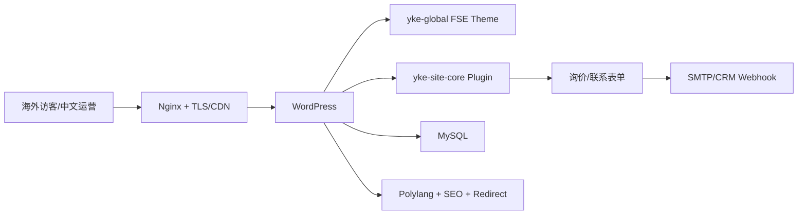

# 云科电气独立站｜技术方案设计文档

## 1. 架构

## 2. 设计决策

- WordPress 提供编辑能力，定制主题控制视觉与组件，核心插件承载产品/案例/表单领域逻辑。
- 英文为默认信息架构，中文使用 `/zh/`；翻译不是字符串替换，而是可独立维护内容。
- 产品、市场、案例和 FAQ 使用结构化内容，避免全部固化在页面编辑器。
- 证据优先：规格、检测、国家覆盖和案例均挂接来源/审批状态，未验证内容不发布。

## 3. 数据与集成

表单保存提交 ID、时间、页面、产品、市场、联系人、同意和送达状态；敏感字段限制访问与留存。邮件只做通知，建议通过 webhook 将线索传入 CRM/AI邀客并使用幂等键防重复。

## 4. SEO 与性能

为产品/案例配置 schema、canonical、hreflang、站点地图和重定向；图片使用现代格式、尺寸和懒加载；缓存/CDN 不缓存表单写请求。Core Web Vitals 与移动端是验收项。

## 5. 安全与运维

最小化插件、及时升级、管理员 MFA、限制登录、WAF/反垃圾、数据库与上传目录备份、恢复演练。生产密钥只由环境注入；SMTP、WordPress salts 与数据库密码不得进入仓库。
